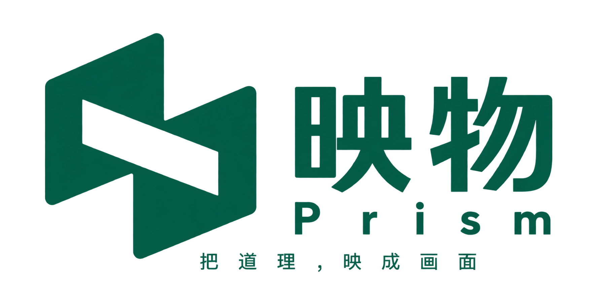
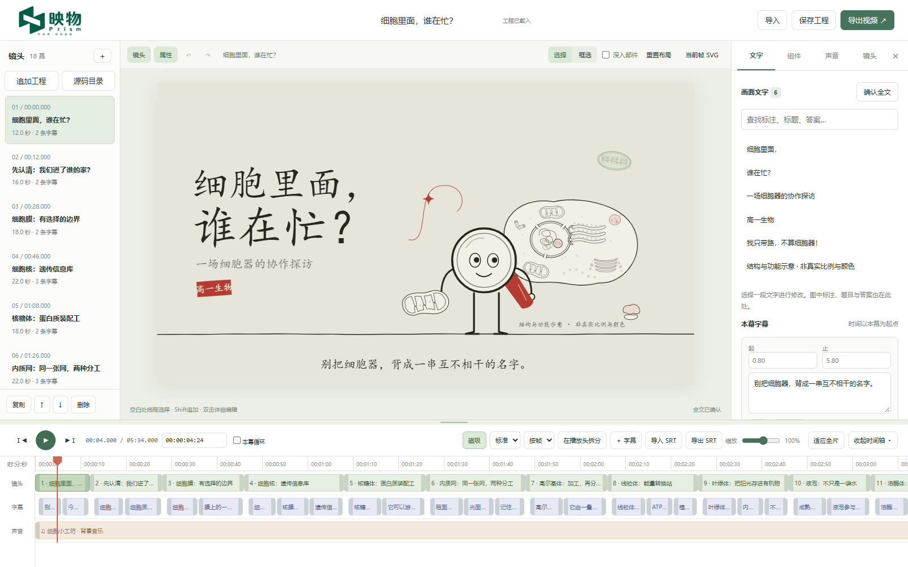

# 映物 · Prism



**把道理，映成画面。**

一个面向教师与知识创作者的本地动画视频工作台。当前支持 SVG 与 Canvas 程序动画混合编辑：让 AI 按公开协议生成完整工程，再由人修改文字、组件和动作参数，精修字幕与时间轴，最后导出视频。

*A local-first editor for editable SVG and Canvas animations. Generate a structured project with AI, refine it by hand, and export MP4 or standalone HTML.*



“映物”取意于宗炳《画山水序》中的“含道映物”。我们希望画面能够帮助理解，也让创作者保留修改每个细节的自由。

## 当前检查点 · v0.4.2 试用版

已接入用户选定的透明 Logo：宽屏页头使用完整标志，窄屏使用独立图标与名称，浏览器标签页使用同一图形。品牌素材与处理说明见 [Logo 资源](app/assets/brand/README.md)。

此检查点保存当前可运行的试用版，包含 Canvas／WebGL 来源读取、按需解码与分块缓存、上层文件夹发现工程、最近导入重开。初次源码导入仍分析全片；最终实现已核验 E02，其余三集的最终统一回归尚未完成，具体依据见 [验证记录](docs/VALIDATION.md)。

前端整体改版仍在设计阶段：[工程首页概念](docs/assets/prism-product-concept-v2/home-v2.png)、[编辑工作台概念](docs/assets/prism-product-concept-v2/editor-v2.png)。这两张是视觉提案，当前网页已实装的是 Logo，操作布局沿用现有工作台。

## 能做什么

- **图文编辑**：修改标题、标注、气泡与字幕；直接拖动、缩放、旋转、隐藏或删除组件。
- **通用来源与参数**：SVG 和 Canvas 使用统一时间轴、对象选择和编辑历史；Canvas 根据来源声明提供颜色、速度、姿态选项等参数控件。
- **混合工程**：将另一工程追加到时间轴，保留对象修改、素材引用和新增音轨的相对位置。
- **上层目录与最近导入**：递归发现源码工程和已保存工程，多个候选由用户选择；最近12个本机导入副本可一键重开。
- **源码目录读取**：直接选择HTML／JavaScript Canvas工程，支持二维画面经WebGL后期合成，自动识别可编辑绘制对象，保留原动画和源码；无需手工改写成映物格式。[支持范围](docs/07-原始源码目录读取.md)
- **框选与批量操作**：Shift 追加选择、整体移动；支持各自缩放与整体缩放。
- **自由工作区**：镜头列表、属性区与时间轴按需展开，时间轴高度可拖动调整。
- **精细时间轴**：连续拖动播放头、帧级缩放、磁吸与参考线、精确时间码、对齐、拆分、裁剪与排序。
- **音乐与配音**：导入音频、录音入口、调整源入点、全片位置、音量及淡入淡出。
- **可恢复的工程**：撤销／重做、本机草稿；小工程保存 JSON，独立素材随 `.prism` 工程包保存与重新导入。
- **统一输出**：预览与导出共用渲染器，支持 MP4、独立播放 HTML 和当前帧 SVG。
- **导出加速**：自动、快速与兼容三种模式；分批视频编码保留音画时序，短任务和不支持的效果明确选用兼容方式。[实测数据](docs/05-性能优化方案.md)

## 快速开始 · Windows

当前版本主要在 **Windows + Microsoft Edge** 上验证。工作台通过本机 Python 服务运行，基础编辑无需 Node.js 构建或 AI API Key。读取 HTML／JavaScript 源码目录另需 Node.js 与分析器依赖，见下方说明。

1. 安装 Python、PowerShell 7 和 Microsoft Edge；导出 MP4 还需要 FFmpeg／ffprobe，并加入 PATH。
2. 从 [Releases](https://github.com/falling-feather/Prism/releases) 下载已发布版本；试用当前检查点可克隆本仓库：

   ```powershell
   git clone https://github.com/falling-feather/Prism.git
   cd Prism
   ```

3. 双击根目录 **`启动映物.bat`**。首次运行会在 `app/.venv` 创建虚拟环境并安装固定版本的 Playwright，首次安装需要网络。
4. 浏览器打开 **http://127.0.0.1:8765/**。默认载入细胞结构示例，也可导入自己的工程。若旧服务占用端口，启动器会在8765–8774中复用新版或选择空闲端口。

已有 Python 环境时，也可以手动启动：

```powershell
cd app
python -m venv .venv
.venv/Scripts/python.exe -m pip install -r requirements.txt
.venv/Scripts/python.exe -X utf8 tools/server.py --open
```

服务仅监听本机。不要直接双击 `app/index.html` 代替启动服务。网页编辑和 MP4 导出需要本机服务；GitHub 仓库发布源码和下载包，不提供 GitHub Pages 在线剪辑。

### 首次使用源码目录读取

安装 Node.js 后，在仓库根目录执行一次以下命令，再从工作台选择“源码目录”。本机验证使用 Node 24.20.0；基础 SVG／Canvas 协议工程编辑不需要该分析器。

```powershell
npm ci --prefix app/tools/source-import
```

此步骤安装固定版本的 JavaScript 解析与打包依赖，需要网络；后续读取本机源码目录不依赖在线 AI 服务。

## 先试一个完整工程

通用编辑示例：[参数化时钟](app/cases/universal/clockwork.svgfilm.json)、[图片与文字](app/cases/universal/cards.svgfilm.json)、[SVG／Canvas 混合工程](app/cases/universal/mixed.svgfilm.json)。导入后选择“指针”，可在属性区调整转速和长度；使用“追加工程”可合并不同来源。

导入 [6 秒动画示例](.agents/skills/svgfilm-authoring/assets/minimal.svgfilm.json)，尝试修改标题、移动组件、调整字幕，再保存回读和导出视频。已有动画会与教师的布局修改共同保留。

详细操作见 [工作台使用手册](app/README.md)。

## 让其他 AI 制作兼容视频

推荐路径：**阅读工程协议 → 接收题材、风格和文稿要求 → 输出完整工程 → 导入映物微调**。

| 使用方式 | 入口 |
| --- | --- |
| AI 支持 Skill | [svgfilm-authoring](.agents/skills/svgfilm-authoring/SKILL.md)，连同 references、assets 和 scripts 一起载入 |
| AI 只支持提示词或附件 | [完整单文件引导协议](docs/SVGFilm-AI-引导协议.md) |
| 查看开发接口 | [SVGFilm 0.4 协议入口](app/docs/SVGFilm_工程格式_v0.4.md) |
| 校验生成的工程 | [真实工作台校验脚本](.agents/skills/svgfilm-authoring/scripts/check_project.py) |

Skill 随当前项目放在 `.agents/skills/`，不安装到全局。协议约束开发接口，风格与文稿流程可独立指定。

```powershell
app/.venv/Scripts/python.exe -X utf8 .agents/skills/svgfilm-authoring/scripts/check_project.py 作品.svgfilm.json --check-portable
```

## 输入与边界

| 输入 | 行为 |
| --- | --- |
| SVGFilm 0.4 JSON | 完整编辑工程；SVG 使用 `svg-keyframes-v1`，Canvas 使用 `canvas-program-v1` |
| SVGFilm 0.2／0.3 / 受支持的旧细胞工程 | 保留已有编号和修改，迁移后继续编辑 |
| `.prism` / `.zip` / `.svgfilm` | 唯一工程 JSON 与按清单登记的独立素材 |
| 映物导出的 HTML | 恢复其中的完整工程数据 |
| 普通 SVG | 解析图形、分组与真实文字，作为静态镜头；检测到脚本／动画时明确提示未保留 |

SVG 动画支持位移、统一缩放、旋转和透明度关键帧。Canvas 程序通过规定的对象与参数接口在隔离环境中绘制，保留原生 Canvas 2D 表现。任意 HTML、CSS／SMIL、三维或 MP4 不会自动转换成可编辑对象；当前没有完整关键帧曲线编辑器。现有网页工程须提供匹配的来源接口，不能只修改扩展名。架构与适配边界见[通用编辑说明](docs/06-通用编辑架构.md)。

工程清单上限120 MiB，工程包上限4 GiB，单音频2 GiB，单图片／字体80 MiB；500幕／16条音轨／2小时，1–60fps。音轨使用全片时间，镜头剪辑不会自动移动音轨。删除组件从当前镜头画面移除，可撤销或取消隐藏恢复。Canvas 可随包声明字体；未打包的本机字体换电脑时可能被替代。

## 项目结构

```text
app/                             工作台、渲染器、本机服务、测试与内置案例
.agents/skills/svgfilm-authoring/  工程协议 Skill、示例与校验工具
docs/                            公开设计文档、纯提示词协议与截图
启动映物.bat                     Windows 启动入口
```

本地运行环境、测试产物、导出视频和历史研究资料不进入公开版本库。

## 开发与验证

前端使用原生 JavaScript ES Modules；本机服务与 FFmpeg 导出使用 Python。开发测试需要 Node.js，当前验证环境为 Node 24、Python 3.14、Microsoft Edge。

```powershell
node --test app/tests/*.test.mjs
app/.venv/Scripts/python.exe -X utf8 app/tests/browser_smoke.py
app/.venv/Scripts/python.exe -X utf8 app/tests/animation_browser.py
app/.venv/Scripts/python.exe -X utf8 app/tests/component_delete.py
```

浏览器测试需先启动本机服务，可通过 `SVGFILM_URL` 指定测试地址。更多时间轴、布局、音频与导出测试见 [app/tests](app/tests)。首次发布的验证范围见 [验证记录](docs/VALIDATION.md)。其他操作系统、完整长片及真实麦克风录音尚未全面验收。

## 许可证

[MIT](LICENSE) · Copyright © 2026 falling-feather。外部依赖和素材说明见 [THIRD_PARTY_NOTICES.md](THIRD_PARTY_NOTICES.md)。
