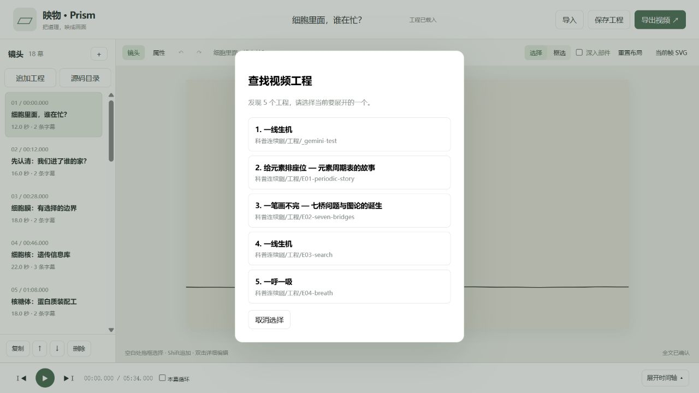
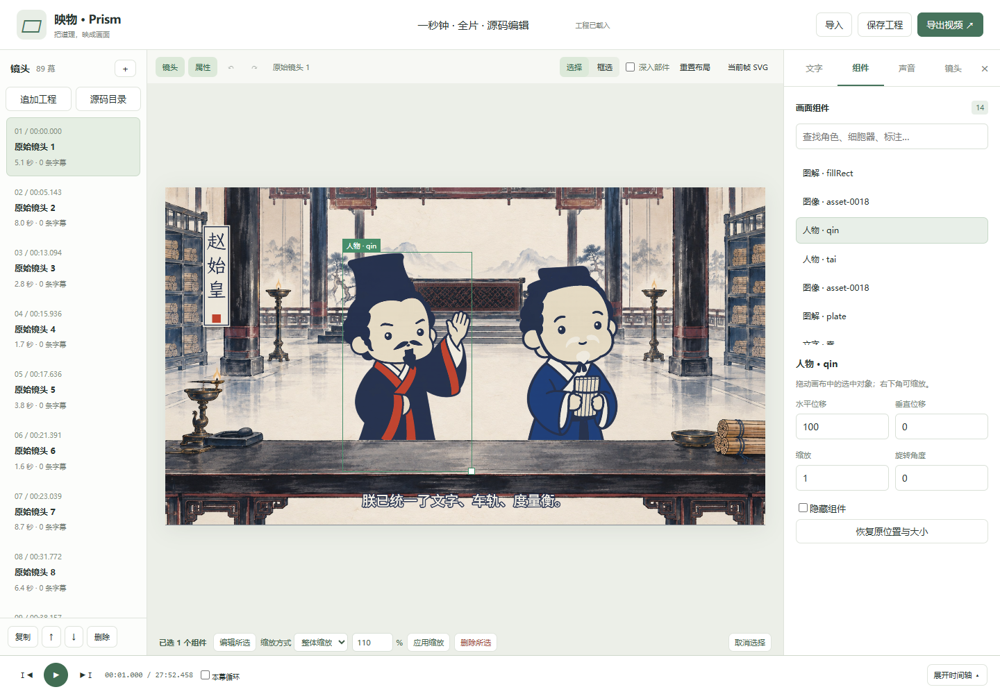

# 原始源码目录读取 · v0.4.2 试用版

这项能力属于编辑器的通用导入流程。用户点击“源码目录”选择原始工程，编辑器读取HTML／JavaScript、资源及绘制结构，建立可编辑对象；不要求用户先把工程改成SVGFilm格式。输入文件只读，转换与分析结果保存在本机缓存中。

## 当前支持范围

- 工程根目录有index.html，包含一个明确的主Canvas与一个JavaScript入口；入口可继续import本地模块。
- 页面提供按秒寻帧的`window.render(t)`和`window.DUR`。支持Canvas 2D，以及将二维画面上传为纹理后进行WebGL合成的后期链路、本地图片、字体和JSON资源，以及在缓冲画布中绘制后合成的画面。
- 辅助绘制函数和直接Canvas绘制调用都可以识别。对象按源函数／调用位置登记，保留父子关系、坐标变换和原始动画；转场缓冲区的对象编辑会在合成前作用到实际绘制。
- 可以独立选择、移动、缩放、旋转、隐藏绘制对象，修改识别出的文字内容、位置、字体、字号和颜色。原程序自行控制的换行宽度不显示为可用编辑能力。

识别粒度来自绘制结构：图片人物仍是图片；竖排文字可能按单字登记，复合图解可能作为带文字子对象的分组。当前不自动恢复人物骨骼、不提供路径节点编辑，也不把任意动作代码自动转成速度／姿态等语义参数。

DOM布局、原生三维网格、远程依赖及只依靠实时累积状态的动画需要后续读取适配器。不能确定边界的Path2D会在分析摘要中明确列为暂不能独立编辑，不能以整幅画面冒充解构成功。独立音轨若由网页之外的制作流程生成，仍从“声音”面板导入。

## 用户操作

1. 点击顶部“导入 → 选择文件夹并查找工程”，或左侧“源码目录”。可以选择上层目录；编辑器逐层检查入口和已保存的工程清单，只读取选中作品的源码与资源。发现多个候选时，按名称和相对路径选择一个；测试副本也会列出，不会擅自合并。
2. 等待读取代码与素材、分析各镜头和原始帧对照。处理过程可以取消；同一服务同时处理一个源码工程。
3. 查看识别摘要，点击“开始编辑”。单击对象选择分组，使用“深入部件”选择内部文字等对象。
4. “导入”弹窗显示最近12个成功导入的本机副本，点击即可重开，不重新扫描源码。记录跨浏览器刷新与服务重启保留；原目录有更新时需重新选择。记录不是原文件的实时链接，跨电脑仍使用工程包。
5. 保存`.prism`工程包，下次直接打开工程包继续编辑。原始源码文件、素材、编辑对象和修改记录一同保留，不需要再次手工转换目录。

上层目录发现工程的当前界面：



下图为直接读取《一秒钟》源目录后的编辑界面。人物单独移动，名牌中的替换字仅用于验证；原始工程未被改写。



初次使用源码读取需要Node.js及分析依赖，在项目根目录运行：

```powershell
npm install --prefix app/tools/source-import
```

当前验证环境使用Node 24.20.0。已有结构化工程的播放与编辑继续使用原有Python服务，不要求Node构建前端。

## 模块职责

| 模块 | 职责 |
| --- | --- |
| `src/source-upload.mjs` | 读取目录、保留源码与图像资源、流式构造上传包，不读取成片MP4 |
| `tools/source_jobs.py` | 安全接收目录、管理分析进度与取消 |
| `tools/source-import/read-project.mjs` | 读取HTML／模块及资源，构建隔离运行入口 |
| `tools/source-import/instrument.mjs` | 按语法树识别绘制函数与调用位置，建立稳定的源码对应关系 |
| `src/source-bridge.mjs` | 观察实际绘制，识别文字、图像与图解边界，处理缓冲区合成 |
| `src/canvas-capture.mjs` | 将对象修改施加到原始绘制调用，保持函数返回值与绘制状态 |
| `tools/import_canvas_source.py` | 复用实际工作台运行时采样、原图对照、生成对象目录及工程 |

工程使用`canvas-source-v1`来源。`objects`中的`ranges`限定相关镜头的登记范围；`textVariants`与`nativeDefault`区分原程序的动态文字和用户明确修改，避免冻结原有表达式。`files`按相对路径关联原始源码资源；实际字段以[source-contract.mjs](../app/src/source-contract.mjs)与[Canvas运行时](../app/src/canvas-worker.mjs)为准。

对象ID由源码位置及绘制上下文产生，稳定性针对同一份源码版本。源代码结构变更后的编辑迁移仍需匹配机制；当前不会假定任意两版代码中的对象可以自动对应。

## 开发与验收

同一读取器用于《一秒钟》及独立生成的“辅助函数绘制”“直接调用＋缓冲区合成”目录，没有片名、人物或剧本分支。除了界面选择框，还检查实际像素变化、撤销、工程包回读和导出。

命令行入口可用于开发与批量验证，但不是用户必须先执行的格式改写步骤：

```powershell
app/.venv/Scripts/python.exe -X utf8 app/tools/import_canvas_source.py 原始工程目录 --out 输出工程.svgfilm.json
```

可通过`--scan-step`控制时间采样密度，`--query`传递源页面本就支持的参数。对未采样到的动态分支，不宣称已经完成全语义还原。采样与原始画面对照的结果、未支持项保存在导入摘要中。验证记录见[VALIDATION.md](VALIDATION.md)。

## 0.4.2 的渲染与适配边界

- WebGL保留原始着色器、辉光与调色；对象编辑施加到二维纹理层的实际绘制。选择框按二维纹理坐标定位，不恢复三维网格、任意着色器形变或路径节点。渐变文字保留原填充，暂不提供颜色停靠点编辑。
- 没有分镜清单的源码按15秒建立连续编辑片段；它们是时间分块，不冒充自动识别出的叙事镜头。初次导入仍进行全片对象分析。
- Canvas只为当前编辑片段建立选择节点；图片按实际需要解码，缓存目标96 MiB，当前帧必需的图片保留，单帧上限256 MiB。跨片段或15秒窗口回收原程序的缓存与绘制环境，并保留必要的绘制属性。
- 无修改的连续播放走单次原生绘制；暂停、寻帧和编辑重新计算几何。待绘制请求最多一个执行中和一个最新候选，连续拖动也显示已完成的中间结果。预览按可见尺寸降低传输分辨率，导出单独使用目标分辨率。
- 源码ZIP校验与打包放在Worker中执行，取消会结束Worker。输入素材以文件片段组成上传Blob，不先装入完整二进制数组。
- 原程序的WebGL工作缓冲区仍按其自身策略绘制；本版没有对任意着色器实现像素级脏区重画。累积像素状态、跨帧未配对的Canvas保存栈仍可能无法自动适配。

本轮为试用版。通用样例和主要流程已通过；四个真实工程的最终统一回归尚未全部完成，验收状态见[验证记录](VALIDATION.md)。
